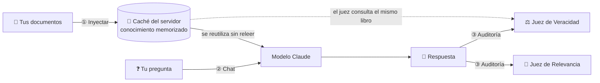

# 🧠 CAG Educativo

**Aprende qué es Cache-Augmented Generation (CAG) viendo un sistema real funcionar:**
cómo un modelo de IA *memoriza* tus documentos, cuánto se ahorra gracias a la caché
y cómo auditamos si lo que responde es verdad.

  

---

## 📚 ¿Qué es CAG? ¿En qué se diferencia de RAG?

Imagina que un estudiante tiene que presentar un examen sobre un libro.

| | 🏃 **RAG** (Retrieval-Augmented Generation) | 🧠 **CAG** (Cache-Augmented Generation) |
|---|---|---|
| **La analogía** | En **cada pregunta** el estudiante corre a la biblioteca, busca unas páginas, las lee y responde. | **Antes del examen** le damos el libro completo para que lo memorice. Luego responde sin buscar. |
| **Cómo funciona** | Los documentos se cortan en fragmentos, se guardan en una base de datos vectorial y en cada pregunta se buscan los más parecidos. | Todos los documentos se cargan completos en la memoria de trabajo del modelo (su *ventana de contexto*) y se guardan en caché. |
| **Ventaja** | Funciona con bibliotecas gigantes. | Sin búsqueda: nada se pierde porque "el bibliotecario trajo la página equivocada". Más simple. |
| **Límite** | Si la búsqueda falla, la respuesta falla. | Todo el conocimiento debe **caber** en la memoria del modelo. |

### ¿Y la "caché"?

Leer un libro entero en cada pregunta sería lento y caro. El **Prompt Caching** de
Anthropic hace que el servidor guarde el trabajo de haber leído el libro (el *KV Cache*):
las preguntas siguientes lo **reutilizan** en vez de releerlo. Es como un estudiante con
memoria fotográfica. Leer desde la caché cuesta **20 veces menos** que leer "en frío".

---

## ⚙️ Cómo funciona este proyecto



La app tiene **tres paneles**:

1. **① Inyección a la caché** — Subes documentos (o usas el de ejemplo). El sistema los
   junta, cuenta sus tokens para comprobar que caben y **precalienta** la caché.
2. **② Chat** — Preguntas lo que quieras. La respuesta aparece palabra por palabra.
3. **③ Transparencia y EVALS** — Ves cuántos tokens salieron de la caché, cuánto costó
   (y cuánto habría costado sin caché) y la calificación de dos jueces:
   - ⚖️ **Veracidad** *(Faithfulness)*: divide la respuesta en afirmaciones y busca la
     **cita textual** del documento que respalda cada una. Si no la encuentra, puede
     ser una **alucinación** (un dato inventado).
     `puntaje = afirmaciones respaldadas ÷ afirmaciones totales`
   - 🎯 **Relevancia** *(Answer Relevancy)*: comprueba si la respuesta contesta lo que
     preguntaste, usando "preguntas inversas" y una rúbrica de 1 a 5.

Ambas métricas están inspiradas en [RAGas](https://docs.ragas.io/) y usan la técnica
**LLM-as-a-Judge**: el mismo modelo, con otras instrucciones, actúa como profesor que
corrige el examen.

### 🗂️ Mapa de archivos

| Archivo | Qué hace |
|---|---|
| [`cag_core.py`](cag_core.py) | El motor CAG: prepara el conocimiento, lo guarda en caché y responde preguntas. |
| [`evals.py`](evals.py) | Los dos jueces (Veracidad y Relevancia) y casos de prueba para "evaluar al evaluador". |
| [`app.py`](app.py) | La interfaz web de tres paneles, hecha con Streamlit. |
| [`datos/manual_cooperativa_nube_alta.md`](datos/manual_cooperativa_nube_alta.md) | Documento de ejemplo **100 % ficticio**: si el modelo "sabe" algo que no está ahí, lo inventó. |

Todo el código está comentado en español, con analogías, para leerse de arriba a abajo.

---

## 🚀 Instalación rápida

**Necesitas:** Python 3.10 o superior y una API key de Anthropic
([consíguela aquí](https://console.anthropic.com/)).

```bash
# 1. Descarga el proyecto y entra en la carpeta
git clone https://github.com/MGranados64/CAG-educativo.git
cd CAG-educativo

# 2. Crea un entorno virtual (una "caja" aislada para las librerías)
python -m venv .venv
source .venv/bin/activate          # Linux/macOS (bash/zsh)
# source .venv/bin/activate.fish   # Linux con fish
# .venv\Scripts\activate           # Windows

# 3. Instala las dependencias
pip install -r requirements.txt

# 4. Configura tu API key (o escríbela después en la barra lateral de la app)
export ANTHROPIC_API_KEY="sk-ant-..."          # bash/zsh
# set -x ANTHROPIC_API_KEY "sk-ant-..."        # fish
# $env:ANTHROPIC_API_KEY="sk-ant-..."          # Windows PowerShell

# 5. ¡Arranca la app!
streamlit run app.py
```

Se abrirá tu navegador en `http://localhost:8501`.

### 🧪 Tres experimentos para empezar

1. **La caché en acción:** pulsa *Inyectar*, haz dos preguntas y compara en el panel ③
   los tokens *leídos de caché* y el ahorro.
2. **Honestidad:** pregunta *"¿Cuál es la capital de Australia?"*. En modo estricto, el
   modelo debe decir que no está en el documento.
3. **Caza de alucinaciones:** activa *"Permitir conocimiento externo"* en la barra lateral
   y repite la pregunta. El juez de Veracidad marcará con ❌ lo que no sale del documento.

### 🖥️ También desde la terminal

```bash
python cag_core.py   # carga el documento de ejemplo y muestra la caché en cada pregunta
python evals.py      # pone a prueba a los jueces con respuestas buenas, inventadas e irrelevantes
```

---

## ☁️ Despliegue (Streamlit Community Cloud)

1. Sube el repositorio a GitHub.
2. En [share.streamlit.io](https://share.streamlit.io) crea una app apuntando a `app.py`.
3. En **Settings → Secrets** agrega:
   ```toml
   ANTHROPIC_API_KEY = "sk-ant-..."
   ```
   ⚠️ **Nunca** subas tu API key al repositorio (el `.gitignore` ya excluye `.env` y
   `.streamlit/secrets.toml`). Si publicas la app con tu key, cualquiera que la use
   gastará tu saldo.

---

## 💵 Costos y detalles técnicos

- **Modelo:** `claude-opus-5-5` (cámbialo con la variable `CAG_MODELO`). La tabla de
  precios del panel ③ solo conoce este modelo; con otro, el costo aparece como "—".
- **Costo aproximado:** unos centavos de dólar por pregunta auditada con el documento de
  ejemplo (respuesta + 2 jueces). El panel ③ muestra el costo real de cada llamada.
- **Caché:** dura 5 minutos (o 1 hora, a elegir) desde su último uso. Por debajo de
  512 tokens el servidor no guarda en caché.
- **Red de seguridad:** si los filtros de seguridad del modelo rechazan una petición,
  el servidor reintenta automáticamente con un modelo de respaldo
  (`fallbacks="default"`, función *beta* de la API).

---

## 🎓 Propósito educativo

Este proyecto existe para **enseñar**, no para producción. Está pensado para que
cualquier persona, incluso sin experiencia en programación o IA, pueda:

- entender la diferencia entre **CAG** y **RAG** con un ejemplo que funciona;
- **ver** la caché trabajando (tokens reutilizados, latencia y ahorro);
- aprender a **auditar** una IA: medir alucinaciones y relevancia con evidencia visible.

Los jueces también son IA y pueden equivocarse: por eso muestran su evidencia y su
razonamiento. **Tú tienes la última palabra.**

---

## 📄 Licencia

[MIT](LICENSE): úsalo, modifícalo y compártelo libremente.
