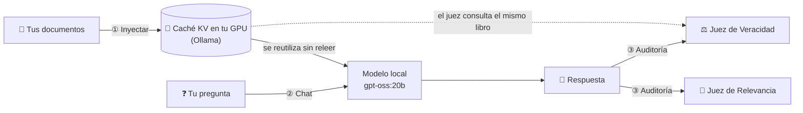

# 🧠 CAG Educativo

**Aprende qué es Cache-Augmented Generation (CAG) viendo un sistema real funcionar:**
cómo un modelo de IA *memoriza* tus documentos, cuánto acelera la caché y cómo
auditamos si lo que responde es verdad.

**100 % gratis y privado:** todo corre en tu computadora con [Ollama](https://ollama.com).
Sin API keys, sin pagos y sin enviar tus documentos a nadie.

    

---

## 📚 ¿Qué es CAG? ¿En qué se diferencia de RAG?

Imagina que un estudiante tiene que presentar un examen sobre un libro.

| | 🏃 **RAG** (Retrieval-Augmented Generation) | 🧠 **CAG** (Cache-Augmented Generation) |
|---|---|---|
| **La analogía** | En **cada pregunta** el estudiante corre a la biblioteca, busca unas páginas, las lee y responde. | **Antes del examen** le damos el libro completo para que lo memorice. Luego responde sin buscar. |
| **Cómo funciona** | Los documentos se cortan en fragmentos, se guardan en una base de datos vectorial y en cada pregunta se buscan los más parecidos. | Todos los documentos se cargan completos en la memoria de trabajo del modelo (su *ventana de contexto*) y se guarda su caché KV. |
| **Ventaja** | Funciona con bibliotecas gigantes. | Sin búsqueda: nada se pierde porque "el bibliotecario trajo la página equivocada". Más simple. |
| **Límite** | Si la búsqueda falla, la respuesta falla. | Todo el conocimiento debe **caber** en la memoria del modelo. |

### ¿Y la "caché"?

Para leer un texto, el modelo calcula unas notas internas por cada token (las
*claves y valores*, o **caché KV**). Ollama las conserva en la memoria de tu tarjeta
gráfica: si la siguiente pregunta empieza con el mismo libro, el modelo **no lo vuelve
a leer**, consulta sus apuntes. En nuestras pruebas, la lectura del documento de
ejemplo bajó de **0.25 s a 0.03 s** (~9× más rápido).

👉 **¿Quieres entenderlo a fondo?** Lee la [**Teoría de CAG en 10 minutos**](TEORIA.md):
ligera, con analogías y con fuentes científicas (también está dentro de la app).

---

## ⚙️ Cómo funciona este proyecto



La app tiene un **🧪 Laboratorio** con tres paneles y una página de **📖 Teoría**:

1. **① Inyección a la caché**: eliges un modelo instalado y tus documentos (o el de
   ejemplo). El sistema calcula el tamaño de la "mesa" (`num_ctx`), comprueba que el
   libro cabe y lo lee una vez **midiendo cuánto tarda en frío**.
2. **② Chat**: preguntas lo que quieras y la respuesta aparece palabra por palabra.
3. **③ Transparencia y EVALS**: ves si el modelo **recordó** el libro (lectura casi
   instantánea) o tuvo que releerlo, y la calificación de dos jueces:
   - ⚖️ **Veracidad** *(Faithfulness)*: divide la respuesta en afirmaciones y busca la
     **cita textual** del documento que respalda cada una. Si no la encuentra, puede
     ser una **alucinación**. `puntaje = respaldadas ÷ totales`
   - 🎯 **Relevancia** *(Answer Relevancy)*: comprueba si contestó lo que preguntaste,
     con "preguntas inversas" y una rúbrica de 1 a 5.

Ambas métricas están inspiradas en [RAGAS](https://aclanthology.org/2024.eacl-demo.16/)
y usan la técnica **LLM-as-a-Judge**: el mismo modelo, con otras instrucciones, actúa
como profesor que corrige el examen.

### 🗂️ Mapa de archivos

| Archivo | Qué hace |
|---|---|
| [`cag_core.py`](cag_core.py) | El motor CAG: prepara el conocimiento, elige `num_ctx`, precalienta la caché y responde. |
| [`evals.py`](evals.py) | Los dos jueces y casos de prueba para "evaluar al evaluador". |
| [`app.py`](app.py) | La puerta de entrada de la app (el índice de páginas). |
| [`paginas/laboratorio.py`](paginas/laboratorio.py) | Los tres paneles del laboratorio. |
| [`paginas/teoria.py`](paginas/teoria.py) + [`TEORIA.md`](TEORIA.md) | La teoría, ligera y con fuentes. |
| [`datos/manual_cooperativa_nube_alta.md`](datos/manual_cooperativa_nube_alta.md) | Documento de ejemplo **100 % ficticio**: si el modelo "sabe" algo que no está ahí, lo inventó. |

Todo el código está comentado en español, con analogías, para leerse de arriba a abajo.

---

## 🚀 Instalación rápida

**Necesitas:** Python 3.10 o superior y [Ollama](https://ollama.com/download).

```bash
# 1. Descarga el modelo recomendado (≈ 13 GB, una sola vez)
ollama pull gpt-oss:20b

# 2. Descarga el proyecto y entra en la carpeta
git clone https://github.com/MGranados64/CAG-educativo.git
cd CAG-educativo

# 3. Crea un entorno virtual (una "caja" aislada para las librerías)
python -m venv .venv
source .venv/bin/activate          # Linux/macOS (bash/zsh)
# source .venv/bin/activate.fish   # Linux con fish
# .venv\Scripts\activate           # Windows

# 4. Instala las dependencias
pip install -r requirements.txt

# 5. ¡Arranca la app! (con Ollama encendido)
streamlit run app.py
```

Se abrirá tu navegador en `http://localhost:8501`.

### 🤖 ¿Qué modelo usar?

La app muestra todos los modelos de chat que tengas instalados en Ollama; puedes
probar cualquiera. Estos son los resultados de nuestras pruebas con el documento de
ejemplo en una **NVIDIA RTX 5070 Ti (16 GB)**:

| Modelo | ¿Calculó bien las vacaciones? | Como juez | Velocidad de escritura | Memoria de video |
|---|---|---|---|---|
| **`gpt-oss:20b`** ⭐ (razonamiento medio) | ✅ | ✅ correcto, ~6 s | ~165 tokens/s | ~12 GB |
| `gemma4:12b` con razonamiento | ✅ | ✅ excelente, pero ~17 s | ~80 tokens/s | ~8.4 GB |
| `gemma4:12b` sin razonamiento | ❌ | ✅ excelente | ~80 tokens/s | ~8.4 GB |
| `gemma4:latest` (8B) | ❌ | ✅ bueno | ~160 tokens/s | ~3.4 GB |

¿Tu equipo tiene menos memoria? `gemma4:latest` ocupa solo ~3.4 GB (activa *Razonar
primero* para que calcule mejor); también puedes bajar el límite de la mesa con
`CAG_NUM_CTX_MAXIMO`. Ollama también funciona solo con CPU, pero más lento.

### 🧪 Cuatro experimentos para empezar

1. **La caché en acción:** pulsa *Inyectar*, haz dos preguntas y mira en el panel ③
   el mensaje *"Recordó el libro"* y el tiempo de lectura.
2. **🧨 Romper la caché:** activa ese interruptor en la barra lateral y repite una
   pregunta. Al cambiar el inicio del prompt, el modelo tiene que releer todo.
3. **Honestidad:** pregunta *"¿Cuál es la capital de Australia?"*. En modo estricto,
   el modelo debe decir que no está en el documento.
4. **Caza de alucinaciones:** activa *"Permitir conocimiento externo"* y repite la
   pregunta. El juez de Veracidad marcará con ❌ lo que no sale del documento.

### 🖥️ También desde la terminal

```bash
python cag_core.py   # carga el documento de ejemplo y muestra la lectura en frío vs. con caché
python evals.py      # pone a prueba a los jueces con respuestas buenas, inventadas e irrelevantes
```

### ⚙️ Ajustes opcionales (variables de entorno)

| Variable | Para qué | Valor por defecto |
|---|---|---|
| `CAG_MODELO` | Modelo preseleccionado | `gpt-oss:20b` |
| `CAG_NUM_CTX_MAXIMO` | Mesa máxima (ajústala a la memoria de tu GPU) | `65536` |
| `OLLAMA_HOST` | Dónde está el servidor de Ollama | `http://localhost:11434` |

---

## 🎓 Propósito educativo

Este proyecto existe para **enseñar**, no para producción. Está pensado para que
cualquier persona, incluso sin experiencia en programación o IA, pueda:

- entender la diferencia entre **CAG** y **RAG** con un ejemplo que funciona;
- **ver** la caché trabajando y **romperla** a propósito para entender por qué funciona;
- conocer los límites reales de CAG, como el **truncado silencioso** cuando el libro no cabe;
- aprender a **auditar** una IA: medir alucinaciones y relevancia con evidencia visible.

Los jueces también son IA (y aquí son el mismo modelo que responde), así que pueden
equivocarse: por eso muestran su evidencia y su razonamiento. **Tú tienes la última
palabra.**

---

## 📄 Licencia

[MIT](LICENSE): úsalo, modifícalo y compártelo libremente.
